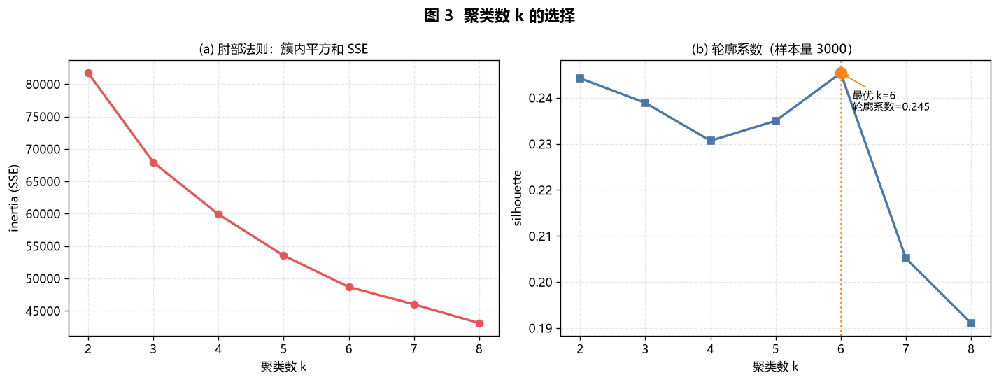
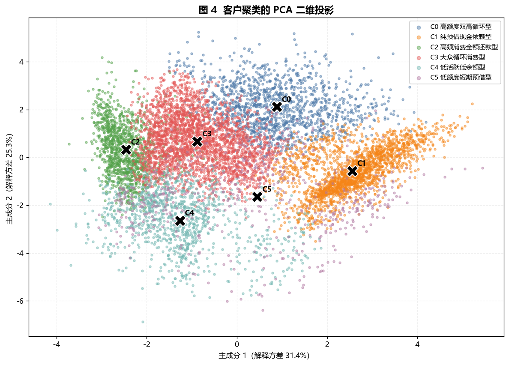
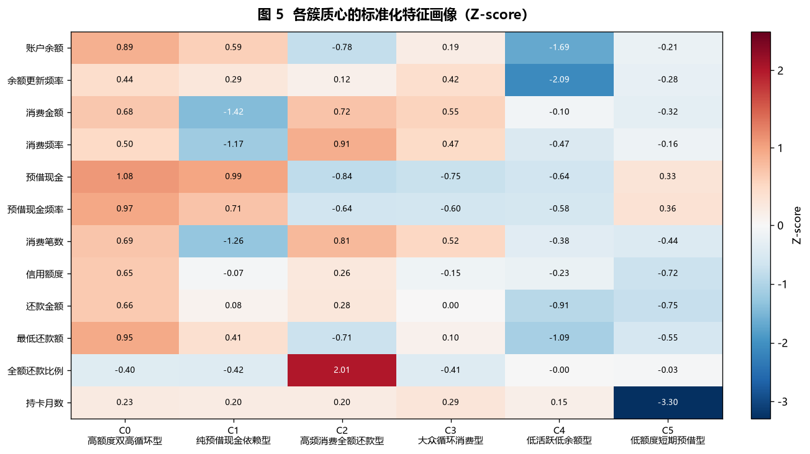
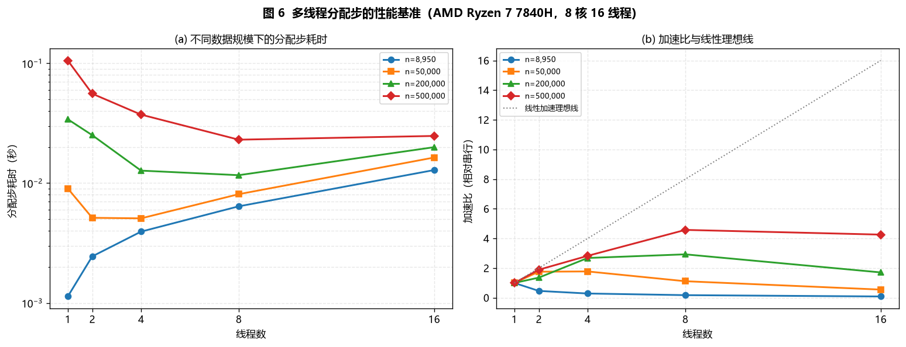
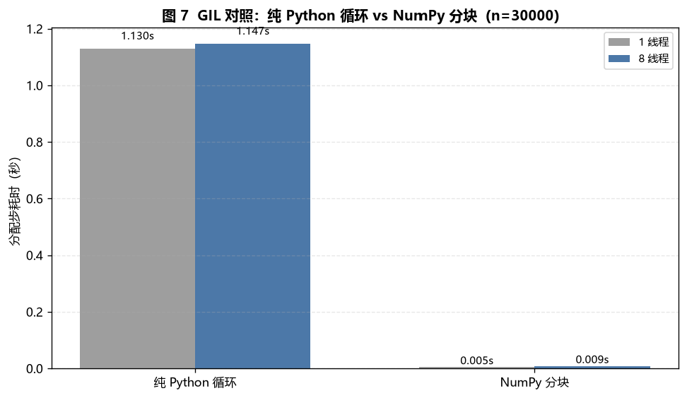

# 基于多线程 K-means++ 的 Kaggle 信用卡客户聚类分析

> **实验代码**：[kmeans_parallel.py](kmeans_parallel.py)  
> **数据集**：[Kaggle — Credit Card Dataset for Clustering (CC GENERAL)](https://www.kaggle.com/datasets/arjunbhasin2013/ccdata)  
> **报告说明**：本文档使用 Markdown 编写，可直接用 Typora 打开；图片使用相对路径，需与 `figures/` 文件夹一起浏览。

---

## 摘要

本实验以 Kaggle 的信用卡客户行为数据集 **CC GENERAL** 为对象，手写实现 K-means++ 聚类算法，并将算法中最耗时的**分配步（assignment step）**改造为基于 `ThreadPoolExecutor` 的多线程分块并行版本。实验先用肘部法则与轮廓系数选择簇数，再从余额、消费、预借现金、还款等 12 个行为维度对 8950 名持卡人进行客户细分，最后对分配步做不同数据规模、不同线程数的性能基准与 GIL 对照实验。

主要结果：

- 轮廓系数在 **k = 6** 时达到最高值 **0.2454**，最终模型的 SSE 为 **48680.69**；
- 6 个客户群体在消费、预借现金、还款行为上呈现出清晰差异，可分别命名为高额度双高循环型、纯预借现金依赖型、高频消费全额还款型、大众循环消费型、低活跃低余额型、低额度短期预借型；
- 手写算法与 `sklearn.cluster.KMeans` 的调整兰德指数 **ARI = 0.9982**，SSE 仅相差 0.146，说明实现正确；
- 多线程分配步在 **n = 500000、8 线程**时取得 **4.58 倍**加速、**57%** 并行效率；但在原始 **n = 8950** 的数据上，线程调度开销超过计算量，多线程反而慢于串行；
- 纯 Python 循环版本在 8 线程下几乎没有加速（1.1302 s → 1.1469 s），而 NumPy 分块版本能利用 C 层释放 GIL 获得加速，说明**“多线程能否加速”取决于计算是否释放 GIL，以及单次任务的计算量是否足够大**。

---

## 一、实验目的

1. 理解 K-means 与 K-means++ 的目标函数、初始化方法和 Lloyd 迭代过程；
2. 掌握 K-means++ 按 \(D(x)^2\) 概率采样初始质心的原理；
3. 使用 Python 的 `concurrent.futures.ThreadPoolExecutor` 对分配步做分块并行；
4. 理解 Python GIL、NumPy 的 GIL 释放机制以及线程数、数据规模对加速比的影响；
5. 掌握缺失值处理、右偏变量对数变换、Z-score 标准化等聚类预处理步骤；
6. 使用肘部法则与轮廓系数选择聚类数 k；
7. 对 Kaggle 信用卡客户数据进行客户细分，并结合业务含义解释各群体；
8. 使用 PCA 降维可视化高维聚类结果，并与 scikit-learn 的实现进行一致性校验。

---

## 二、数据集介绍

### 2.1 数据来源

本实验使用 Kaggle 上的 **Credit Card Dataset for Clustering** 数据集，文件名为 `CC GENERAL.csv`。

- 数据集主页：<https://www.kaggle.com/datasets/arjunbhasin2013/ccdata>
- 数据规模：**8950 行 × 18 列**（其中 1 列为客户编号，17 列为数值型行为特征）
- 数据内容：约 9000 名信用卡持卡人在一段时间内的账户余额、消费、预借现金、还款、信用额度等行为指标。

该数据集是聚类任务中常用的公开数据集：它没有标签，特征全部为数值型，且同时包含金额、频率、次数、比例等多种量纲，非常适合用来演示“预处理 → 选 k → 聚类 → 画像 → 解释”的完整流程。

### 2.2 字段说明

| 字段 | 含义 | 类型 | 是否建模 |
| --- | --- | --- | --- |
| `CUST_ID` | 客户编号 | 字符串 | 否（标识列，删除） |
| `BALANCE` | 账户余额 | 金额 | 是 |
| `BALANCE_FREQUENCY` | 余额更新频率，0~1 | 比例 | 是 |
| `PURCHASES` | 消费金额 | 金额 | 是 |
| `ONEOFF_PURCHASES` | 一次性消费金额 | 金额 | 否（`PURCHASES` 的分项） |
| `INSTALLMENTS_PURCHASES` | 分期消费金额 | 金额 | 否（`PURCHASES` 的分项） |
| `CASH_ADVANCE` | 预借现金金额 | 金额 | 是 |
| `PURCHASES_FREQUENCY` | 消费频率，0~1 | 比例 | 是 |
| `ONEOFF_PURCHASES_FREQUENCY` | 一次性消费频率 | 比例 | 否（消费频率的分项） |
| `PURCHASES_INSTALLMENTS_FREQUENCY` | 分期消费频率 | 比例 | 否（消费频率的分项） |
| `CASH_ADVANCE_FREQUENCY` | 预借现金频率 | 比例 | 是 |
| `CASH_ADVANCE_TRX` | 预借现金交易次数 | 次数 | 否（与 `CASH_ADVANCE` 高度相关） |
| `PURCHASES_TRX` | 消费交易次数 | 次数 | 是 |
| `CREDIT_LIMIT` | 信用额度 | 金额 | 是 |
| `PAYMENTS` | 还款金额 | 金额 | 是 |
| `MINIMUM_PAYMENTS` | 最低还款额 | 金额 | 是 |
| `PRC_FULL_PAYMENT` | 全额还款比例，0~1 | 比例 | 是 |
| `TENURE` | 持卡月数 | 月 | 是 |

最终参与聚类的特征共有 **12 个**：账户余额、余额更新频率、消费金额、消费频率、预借现金、预借现金频率、消费笔数、信用额度、还款金额、最低还款额、全额还款比例、持卡月数。

### 2.3 数据质量

读取数据后，基本情况如下：

| 项目 | 数值 |
| --- | ---: |
| 样本数 | 8950 |
| 原始列数 | 18 |
| 缺失值总数 | 314 |
| `CREDIT_LIMIT` 缺失 | 1 |
| `MINIMUM_PAYMENTS` 缺失 | 313 |
| 重复的 `CUST_ID` | 0 |

其中只有 `CREDIT_LIMIT` 与 `MINIMUM_PAYMENTS` 存在缺失，缺失比例分别约为 0.01% 和 3.50%，属于低比例缺失，不需要删除样本。

---

## 三、实验环境

| 项目 | 配置 |
| --- | --- |
| 操作系统 | Windows 10 / 11（10.0.26200） |
| CPU | AMD Ryzen 7 7840H，8 物理核 / 16 逻辑线程 |
| 内存 | 16 GB |
| Python | 3.11.9 |
| NumPy | 2.4.6 |
| pandas | 3.0.6 |
| scikit-learn | 1.9.1 |
| matplotlib | 3.11.2 |
| 并行方式 | `concurrent.futures.ThreadPoolExecutor`（线程，非进程） |

> 说明：本实验使用**线程**而不是**进程**，原因是 K-means 的分配步是典型的向量化数值计算，NumPy 在 C 层执行矩阵运算时会释放 GIL，线程可以共享同一份数据，避免进程间复制大数组的开销。后文的 GIL 对照实验会验证这一点。

---

## 四、算法原理

### 4.1 K-means 的目标函数

给定样本矩阵 \(X = \{x_1, x_2, \ldots, x_n\}\)，其中 \(x_i \in \mathbb{R}^d\)，要把样本划分成 \(k\) 个簇 \(C_1, C_2, \ldots, C_k\)。K-means 最小化簇内平方和（Within-Cluster Sum of Squares，WCSS，也称 inertia）：

\[
J = \sum_{j=1}^{k} \sum_{x_i \in C_j} \left\| x_i - \mu_j \right\|_2^2
\]

其中 \(\mu_j = \frac{1}{|C_j|}\sum_{x_i \in C_j} x_i\) 是第 \(j\) 个簇的质心。

### 4.2 K-means++ 初始化

标准 K-means 随机选取初始质心，容易陷入较差的局部最优。K-means++ 的核心思想是让初始质心尽量分散：

1. 从样本中**均匀随机**选取第 1 个质心 \(c_1\)；
2. 对每个样本 \(x_i\)，计算它到当前已选质心集合的最短平方距离：
   \[
   D(x_i)^2 = \min_{c \in \mathcal{C}} \left\| x_i - c \right\|_2^2
   \]
3. 以正比于 \(D(x_i)^2\) 的概率选取下一个质心：
   \[
   P(x_i) = \frac{D(x_i)^2}{\sum_{x_l \in X} D(x_l)^2}
   \]
4. 重复步骤 2–3，直到选满 \(k\) 个质心。

距离已有质心越远的样本被选中的概率越大，因此初始质心天然更分散，后续 Lloyd 迭代更容易收敛到较好的局部最优。

### 4.3 分配步与更新步

K-means++ 只负责“选起点”，之后仍然使用 Lloyd 迭代：

**分配步（Assignment Step）**：把每个样本分配给距离最近的质心：

\[
a_i = \arg\min_{j \in \{1,\ldots,k\}} \left\| x_i - \mu_j \right\|_2^2
\]

**更新步（Update Step）**：把每个质心移动到自己簇内样本的均值：

\[
\mu_j \leftarrow \frac{1}{|C_j|} \sum_{x_i \in C_j} x_i
\]

重复“分配—更新”，直到质心位移小于阈值或达到最大迭代次数。

直接计算 \(\|x_i-\mu_j\|^2\) 需要 \(O(nkd)\) 次运算。实现时使用展开式：

\[
\left\| x_i - \mu_j \right\|_2^2
= \left\| x_i \right\|_2^2 - 2 x_i^\top \mu_j + \left\| \mu_j \right\|_2^2
\]

其中 \(\left\| x_i \right\|_2^2\) 与 \(\left\| \mu_j \right\|_2^2\) 可以预先计算，核心开销变为一次形状为 \((n,d)\times(d,k)\) 的矩阵乘法，既避免了构造 \((n,k,d)\) 的三维中间数组，又便于 NumPy 在 C 层执行。

### 4.4 多线程分配步设计

分配步的各样本之间**完全独立**：样本 \(x_i\) 的簇编号只依赖它自己和 \(k\) 个质心，不依赖其他样本。因此可以按行切分数据，让多个线程同时计算不同数据块的最近质心。

实现方案：

1. 把 \(n\) 个样本按行切成 `n_threads × chunk_factor` 个连续块；
2. 每个线程拿到一个块，计算该块到所有质心的平方距离矩阵，并沿质心方向取 `argmin`；
3. 主线程按原顺序拼接各块结果，得到长度为 \(n\) 的标签向量；
4. 整个 Lloyd 迭代复用同一个线程池，避免每轮迭代重复创建线程。

设块数为 \(m\)，第 \(t\) 个块的处理时间为 \(T_t\)，则并行分配步的墙钟时间近似为：

\[
T_{\text{parallel}} \approx \max_{t=1,\ldots,m} T_t + T_{\text{dispatch}} + T_{\text{merge}}
\]

当单块计算量足够大时，\(T_{\text{dispatch}}\) 与 \(T_{\text{merge}}\) 可以忽略，加速比接近线程数；当数据量很小时，调度与合并开销占主导，多线程反而更慢。这正是后文基准实验要验证的现象。

`chunk_factor = 4` 的含义是：每个线程分到约 4 个块。块数多于线程数可以让操作系统在某个线程被调度延迟时，把空闲核心分配给其他块，从而改善负载均衡；但块数过多会增加任务调度与结果拼接开销。

### 4.5 复杂度与收敛条件

| 阶段 | 时间复杂度 | 说明 |
| --- | --- | --- |
| K-means++ 初始化 | \(O(nkd)\) | 每选一个质心扫描一遍样本 |
| 单轮分配步 | \(O(nkd)\) | 并行后理想墙钟为 \(O(nkd/p)\) |
| 单轮更新步 | \(O(nd)\) | 按簇求均值，通常远小于分配步 |
| 完整 Lloyd | \(O(nkd \cdot I)\) | \(I\) 为迭代次数 |

本实验的收敛条件为：

- 质心最大位移 \(\max_j \|\mu_j^{(t)}-\mu_j^{(t-1)}\|_\infty \le 10^{-4}\)，或
- 达到最大迭代次数 100 次。

另外，K-means++ 的初始化带有随机性，本实验用 `n_init = 10` 组不同随机种子重复训练，取 SSE 最小的一组作为最终结果，以降低随机初始化的影响。

---

## 五、数据预处理

### 5.1 缺失值处理

`CREDIT_LIMIT` 只缺 1 条，`MINIMUM_PAYMENTS` 缺 313 条。由于金额类变量右偏严重，均值容易被极端值拉高，因此使用**中位数**填补：

- `CREDIT_LIMIT` 中位数：3000.00；
- `MINIMUM_PAYMENTS` 中位数：312.34。

中位数填补不会改变样本排序，也不会引入极端的“平均客户”，对聚类更稳健。

### 5.2 特征选择

原始数据有 17 个数值特征，但其中若干是另外一些特征的分项，直接全部放入欧氏距离会造成**重复计权**：

- `ONEOFF_PURCHASES` 与 `INSTALLMENTS_PURCHASES` 相加近似等于 `PURCHASES`；
- `ONEOFF_PURCHASES_FREQUENCY` 与 `PURCHASES_INSTALLMENTS_FREQUENCY` 相加近似等于 `PURCHASES_FREQUENCY`；
- `CASH_ADVANCE_TRX` 与 `CASH_ADVANCE` 高度相关（log1p 后相关系数约 0.52 以上，原始量纲下更高）。

因此删除上述 5 个冗余特征，保留 12 个业务含义清晰、相互补充的维度。这样既降低了维度，又避免“消费能力”被重复计算三次。

### 5.3 对数变换

金额和次数类变量右偏非常明显。以原始量纲计算偏度（skewness）：

| 变量 | 原始偏度 | log1p 后偏度 |
| --- | ---: | ---: |
| `BALANCE` | 2.393 | -0.861 |
| `PURCHASES` | 8.144 | -0.764 |
| `CASH_ADVANCE` | 5.167 | 0.263 |
| `PURCHASES_TRX` | 4.631 | 0.033 |
| `CREDIT_LIMIT` | 1.523 | -0.101 |
| `PAYMENTS` | 5.908 | -1.778 |
| `MINIMUM_PAYMENTS` | 13.852 | 0.270 |

`PURCHASES` 的均值为 1003.20，标准差为 2136.63，最大值 49039.57；`MINIMUM_PAYMENTS` 的最大值 76406.21，而中位数只有 312.34。若不处理，少数极端客户会在欧氏距离中占据主导，导致簇被“巨值客户”拉走。

对上述 7 个变量做 \(\log(1+x)\) 变换后，偏度显著下降（部分变量变为轻微左偏，但已接近对称）。对数变换保序且能压缩尾部，是金额型聚类任务的常用做法。

> 说明：频率、比例类变量本身位于 \([0,1]\) 附近，不做对数变换；`TENURE` 取值 6–12，接近常数，保留但不做额外处理。

### 5.4 Z-score 标准化

K-means 使用欧氏距离，量纲差异会直接改变距离。例如余额以“元”为单位，数值可达上万；消费频率在 0–1 之间。若不标准化，余额会完全支配距离。

对每个特征做 Z-score 标准化：

\[
z_{ij} = \frac{x_{ij} - \bar{x}_j}{s_j}
\]

其中 \(\bar{x}_j\) 与 \(s_j\) 分别为第 \(j\) 个特征在训练数据上的均值与标准差。标准化后每个特征的均值为 0、标准差为 1，欧氏距离中各维度具有可比的权重。

> 标准化使用全部 8950 条样本拟合 `StandardScaler`。本实验是无监督聚类，不存在“测试集信息泄漏”的问题；若未来用于新客户分配，应保存该 scaler 并复用同一组均值/标准差。

---

## 六、核心代码实现

完整代码见 [kmeans_parallel.py](kmeans_parallel.py)，下面给出三个关键片段。

### 6.1 K-means++ 初始化

```python
def _kmeans_plusplus(self, X, rng):
    n, d = X.shape
    k = self.n_clusters
    centers = np.empty((k, d), dtype=X.dtype)

    # 第 1 个质心均匀随机
    first = int(rng.integers(n))
    centers[0] = X[first]
    closest = ((X - centers[0]) ** 2).sum(axis=1)

    # 后续质心按 D(x)^2 概率采样
    for j in range(1, k):
        total = float(closest.sum())
        if total <= 0.0:
            idx = int(rng.integers(n))
        else:
            idx = int(rng.choice(n, p=closest / total))
        centers[j] = X[idx]
        new_dist = ((X - centers[j]) ** 2).sum(axis=1)
        closest = np.minimum(closest, new_dist)

    return centers
```

### 6.2 多线程分配步

```python
def _assign_parallel(self, X, centers, executor=None):
    if self.n_threads <= 1:
        return self._assign_sequential(X, centers)

    center_sq = np.einsum("ij,ij->i", centers, centers)
    n_chunks = min(len(X), self.n_threads * self.chunk_factor)
    chunks = [c for c in np.array_split(X, n_chunks) if len(c) > 0]

    def worker(chunk):
        part = np.einsum("ij,ij->i", chunk, chunk)[:, None]
        dist2 = part - 2.0 * (chunk @ centers.T) + center_sq[None, :]
        return np.argmin(dist2, axis=1)

    if executor is None:
        with ThreadPoolExecutor(max_workers=self.n_threads) as ex:
            parts = list(ex.map(worker, chunks))
    else:
        parts = list(executor.map(worker, chunks))

    return np.concatenate(parts)
```

### 6.3 Lloyd 主循环

```python
executor = ThreadPoolExecutor(max_workers=self.n_threads) if self.n_threads > 1 else None
for it in range(self.max_iter):
    labels = self._assign_parallel(X, centers, executor)   # 多线程分配步
    new_centers = self._update_centers(X, labels, centers)  # 串行更新步
    shift = float(np.max(np.abs(new_centers - centers)))
    centers = new_centers
    if shift <= self.tol:
        break
```

更新步需要按簇聚合，各簇之间虽然独立，但聚合后的质心数量只有 \(k\) 个，串行开销很小，因此本实验只并行化分配步，避免过度设计。

---

## 七、实验结果

### 7.1 聚类数 k 的选择

对 \(k = 2, 3, \ldots, 8\) 分别运行 K-means++（每组 3 次初始化），记录 SSE 与轮廓系数：

| k | SSE（inertia） | 轮廓系数 | 迭代次数 | 拟合耗时（s） |
| ---: | ---: | ---: | ---: | ---: |
| 2 | 81716.22 | 0.2443 | 17 | 0.64 |
| 3 | 67930.41 | 0.2389 | 78 | 1.10 |
| 4 | 59893.19 | 0.2307 | 29 | 1.48 |
| 5 | 53528.82 | 0.2350 | 52 | 0.83 |
| **6** | **48680.89** | **0.2454** | **19** | **0.76** |
| 7 | 45997.73 | 0.2051 | 25 | 0.83 |
| 8 | 43105.19 | 0.1911 | 34 | 0.65 |



**肘部法则**：SSE 从 k=2 的 81716 持续下降，k=5 到 k=6 的下降幅度为 4847.93（约 9.1%），k=6 到 k=7 只下降 2683.16（约 5.5%），k=7 到 k=8 为 2892.54（约 6.3%）。曲线在 k=6 附近明显变缓，说明继续增加簇数的边际收益已经很小。

**轮廓系数**：k=6 时取得最大值 0.2454，但 k=2 的 0.2443 几乎相同。这是聚类中常见的“多解”现象：k=2 会把数据粗分为“高消费/预借”和“低活跃”两大类，分离度尚可，但会掩盖预借现金依赖型、全额还款型等业务上完全不同的群体；k=6 的轮廓系数略高，且能得到 6 个可解释、可运营的细分群体，因此最终选择 **k = 6**。

需要说明的是，0.245 左右的轮廓系数并不算高。高维行为数据中簇与簇之间本来就有交叠（见图 4 的 PCA 投影），轮廓系数 0.2–0.3 属于“弱到中等”的分离度，但这不代表聚类无效——它更适合作为“客户分群”而不是“自然类别发现”。

### 7.2 最终聚类结果

使用 k=6、8 线程、`n_init=10` 的最终模型：

| 指标 | 数值 |
| --- | ---: |
| SSE（inertia） | 48680.6921 |
| 迭代次数 | 29 |
| 总拟合耗时 | 2.946 s |
| 其中分配步累计耗时 | 2.276 s |
| K-means++ 初始化累计耗时 | 0.020 s |

各簇规模：

| 簇 | 人数 | 占比 |
| ---: | ---: | ---: |
| C0 | 1344 | 15.02% |
| C1 | 2084 | 23.28% |
| C2 | 1257 | 14.04% |
| C3 | 2610 | 29.16% |
| C4 | 1081 | 12.08% |
| C5 | 574 | 6.41% |

### 7.3 PCA 可视化

PCA 前两个主成分分别解释 **31.42%** 与 **25.33%** 的方差，累计 **56.75%**。虽然二维投影会损失部分信息，但已能看出主要群体的分布结构。



从图 4 可以看到：

- C1（纯预借现金依赖型，橙色）位于主成分 1 的正方向、主成分 2 的负方向，与其他群体明显分离；
- C2（高频消费全额还款型，绿色）位于主成分 1 的负方向，代表“低余额、高消费、全额还款”；
- C0（高额度双高循环型，蓝色）位于主成分 2 的正方向，代表高消费与高预借；
- C3（大众循环消费型，红色）位于中心区域，人数最多，是典型的大众客群；
- C4（低活跃低余额型，青色）与 C5（低额度短期预借型，紫色）交叠较多，说明这两类客户的边界不如其他群体清晰。

二维投影中仍有较多交叠，原因是 12 维空间被压到 2 维、且行为特征之间存在相关性。聚类本身是在 12 维空间进行的，PCA 只用于展示。

### 7.4 客户群体画像

各簇在原始量纲下的均值如下（金额单位与原数据一致）：

| 簇 | 群体名称 | 人数 | 占比 | 余额 | 消费金额 | 预借现金 | 消费频率 | 预借频率 | 信用额度 | 还款金额 | 全额还款率 |
| ---: | --- | ---: | ---: | ---: | ---: | ---: | ---: | ---: | ---: | ---: | ---: |
| C0 | 高额度双高循环型 | 1344 | 15.02% | 3829.67 | 1925.36 | 2697.34 | 0.689 | 0.329 | 6863.76 | 3515.98 | 0.036 |
| C1 | 纯预借现金依赖型 | 2084 | 23.28% | 2315.58 | 23.44 | 1991.61 | 0.020 | 0.277 | 4146.48 | 1715.32 | 0.030 |
| C2 | 高频消费全额还款型 | 1257 | 14.04% | 191.47 | 2003.70 | 35.06 | 0.857 | 0.008 | 5356.27 | 2055.97 | 0.740 |
| C3 | 大众循环消费型 | 2610 | 29.16% | 1232.67 | 1255.49 | 44.17 | 0.680 | 0.015 | 3952.43 | 1326.40 | 0.033 |
| C4 | 低活跃低余额型 | 1081 | 12.08% | 43.96 | 297.55 | 142.52 | 0.300 | 0.019 | 3637.48 | 747.18 | 0.153 |
| C5 | 低额度短期预借型 | 574 | 6.41% | 912.62 | 392.04 | 1170.29 | 0.425 | 0.208 | 2398.73 | 622.76 | 0.146 |

为了更直观地比较各群体相对总体水平的高低，计算“群体均值 / 总体均值”的相对指数（1.0 表示总体平均）：

| 簇 | 余额 | 消费金额 | 预借现金 | 信用额度 | 还款金额 |
| ---: | ---: | ---: | ---: | ---: | ---: |
| C0 | 2.448 | 1.919 | 2.756 | 1.527 | 2.029 |
| C1 | 1.480 | 0.023 | 2.035 | 0.923 | 0.990 |
| C2 | 0.122 | 1.997 | 0.036 | 1.192 | 1.186 |
| C3 | 0.788 | 1.251 | 0.045 | 0.879 | 0.765 |
| C4 | 0.028 | 0.297 | 0.146 | 0.809 | 0.431 |
| C5 | 0.583 | 0.391 | 1.196 | 0.534 | 0.359 |



图 5 展示了标准化空间中的质心画像。红色表示高于总体平均，蓝色表示低于总体平均。可以看到每个群体都有清晰的“特征签名”，而不是随机划分。

### 7.5 各群体的业务解释

#### C0：高额度双高循环型（1344 人，15.02%）

- 余额 3829.67，是总体均值的 **2.45 倍**；
- 消费 1925.36（1.92 倍），预借现金 2697.34（**2.76 倍**），两者都高；
- 信用额度 6863.76，为全体最高（1.53 倍）；
- 还款 3515.98（2.03 倍），但全额还款率只有 **3.57%**；
- 预借频率 0.329，为六类中最高。

这是“高额度、高消费、高预借、低全额还款”的**高价值循环信贷群体**。他们为银行贡献了较多的消费手续费与利息收入，但余额高、预借现金频繁、几乎不全额还款，信用风险也相对集中。运营上应重点监控额度使用率与预借现金频率，必要时进行额度调整或分期转化。

#### C1：纯预借现金依赖型（2084 人，23.28%）

- 消费金额只有 **23.44**，相对指数 0.023，几乎不刷卡消费；
- 预借现金 1991.61，是总体均值的 **2.04 倍**；
- 余额 2315.58（1.48 倍），预借频率 0.277；
- 全额还款率仅 3.0%。

这是典型的**现金预借依赖型**客户：额度主要用于取现而不是消费，账户长期携带余额。此类客户的利息贡献较高，但预借现金通常伴随更高的违约风险，且不产生消费类交易手续费。运营上可评估“预借转消费/分期”的产品引导，同时加强风险监测。

#### C2：高频消费全额还款型（1257 人，14.04%）

- 余额只有 191.47，仅为总体均值的 **12.2%**；
- 消费金额 2003.70（**2.00 倍**），消费频率 0.857，为六类最高；
- 预借现金只有 35.06，预借频率 0.008；
- 全额还款率 **74.02%**，远高于其他群体；
- 信用额度 5356.27（1.19 倍）。

这是质量最高的**交易型客户（transactors）**：高频刷卡、按时全额还款、几乎不预借现金、余额低。银行从他们身上获得的利息收入较少，但消费交易手续费稳定，信用风险最低。运营上适合做消费促活、权益与额度提升，是重点保留群体。

#### C3：大众循环消费型（2610 人，29.16%）

- 人数最多，占近三成；
- 余额 1232.67（0.79 倍），消费 1255.49（1.25 倍），消费频率 0.680；
- 预借现金只有 44.17，预借频率 0.015；
- 全额还款率 3.27%，还款金额 1326.40。

这是**大众循环消费客群**：以刷卡消费为主、不依赖预借现金，但普遍携带余额、很少全额还款。他们是利息收入的基本盘，风险水平中等。运营上适合分期、账单分期、余额转移等产品，同时关注余额/额度比的上升。

#### C4：低活跃低余额型（1081 人，12.08%）

- 余额 43.96，仅为总体均值的 **2.8%**；
- 消费 297.55（0.30 倍），消费频率 0.300；
- 还款 747.18（0.43 倍），全额还款率 15.3%；
- 信用额度 3637.48（0.81 倍）。

这是**低活跃、低余额**客户：用卡频率低、消费少、余额低。银行从他们身上获得的收入有限，但信用风险也低。运营重点是激活：首刷礼、场景化权益、额度使用提醒等；若长期无响应，可考虑降低维护成本。

#### C5：低额度短期预借型（574 人，6.41%）

- 人数最少，仅 6.41%；
- 信用额度 2398.73，仅为总体均值的 **53.4%**，是六类中最低；
- 持卡月数 **7.10**，而总体平均为 11.52，说明多为新客户或短账龄客户；
- 预借现金 1170.29（1.20 倍），预借频率 0.208，相对偏高；
- 消费 392.04（0.39 倍），全额还款率 14.6%。

这是**低额度、短账龄、预借现金相对偏高**的群体。较低的额度可能来自风控策略（新客户/薄档案），而预借行为说明存在短期流动性需求。运营上应谨慎提额，先观察还款表现；适合提供小额分期或预借现金替代产品。

### 7.6 与 scikit-learn 的一致性

为了验证手写实现是否正确，在相同标准化数据、相同 k 下与 `sklearn.cluster.KMeans` 对比：

| 指标 | 手写 K-means++ | sklearn KMeans |
| --- | ---: | ---: |
| 初始化 | K-means++ | K-means++ |
| n_init | 10 | 10 |
| SSE（inertia） | 48680.6921 | 48680.8380 |
| 迭代上限 | 100 | 300 |
| 与手写结果的 ARI | — | **0.9982** |

两者的 SSE 仅相差 **0.146**（相对差异约 \(3.0\times10^{-6}\)），调整兰德指数 ARI 为 **0.9982**（1.0 表示完全一致）。ARI 不受簇编号排列影响，说明两种实现得到的划分几乎相同；少量差异来自初始化随机数、收敛阈值和空簇处理细节。

---

## 八、多线程性能分析

### 8.1 基准方法

性能基准只测**分配步**，不把 K-means++ 初始化、质心更新、绘图等串行部分混入计时。

- 使用最终模型的 6 个质心；
- 以真实标准化数据为模板，有放回重采样并加入标准差 0.02 的高斯扰动，构造 \(n = 8950, 50000, 200000, 500000\) 的基准数据；
- 线程数取 1、2、4、8、16；
- 每组先预热一次，再重复 5 次取中位数；
- 线程池在计时区间外创建并复用，避免把线程创建开销算进单次分配；
- 在 import NumPy 前设置 `OMP_NUM_THREADS=1` 等环境变量，关闭 BLAS 内部多线程，避免与线程池叠加造成线程超额订阅。

> 注意：50 万、20 万规模的基准数据是**由真实样本重采样得到的合成数据**，只用于测量并行性能，不参与 7 节的聚类分析。真实分析始终使用 8950 条原始客户记录。

### 8.2 不同规模与线程数的耗时

分配步耗时（毫秒，越小越好）：

| n | 1 线程 | 2 线程 | 4 线程 | 8 线程 | 16 线程 |
| ---: | ---: | ---: | ---: | ---: | ---: |
| 8,950 | 1.1 | 2.4 | 3.9 | 6.4 | 12.8 |
| 50,000 | 9.0 | 5.1 | 5.1 | 8.1 | 16.3 |
| 200,000 | 34.1 | 25.1 | 12.7 | 11.6 | 19.9 |
| 500,000 | 105.4 | 55.7 | 37.3 | 23.0 | 24.7 |



### 8.3 加速比与并行效率

加速比定义为 \(S(p) = T_1 / T_p\)，并行效率定义为 \(E(p) = S(p)/p\)：

| n | 1 线程 | 2 线程 | 4 线程 | 8 线程 | 16 线程 |
| ---: | ---: | ---: | ---: | ---: | ---: |
| 8,950 | 1.00 | 0.46 | 0.29 | 0.18 | 0.09 |
| 50,000 | 1.00 | **1.76** | 1.78 | 1.12 | 0.55 |
| 200,000 | 1.00 | 1.36 | 2.68 | **2.93** | 1.71 |
| 500,000 | 1.00 | 1.89 | 2.83 | **4.58** | 4.26 |

对应的并行效率：

- 500,000：2 线程 95%，4 线程 71%，8 线程 **57%**，16 线程 27%；
- 200,000：4 线程 67%，8 线程 37%；
- 50,000：2 线程 88%，4 线程 44%；
- 8,950：全部低于 25%，8 线程仅 2%。

**规模效应**：数据量越大，单块计算时间越长，线程调度与结果拼接的相对开销越小，加速比越高。500,000 条、8 线程时达到 **4.58 倍**，接近 8 个物理核的理论上限（受内存带宽、Python 主线程 GIL 交接、块合并等影响，达不到线性 8 倍是正常的）。

**线程数效应**：在本机上，8 线程通常是拐点；16 线程在 500,000 条时反而不如 8 线程（4.26 vs 4.58），在 200,000 条时更明显（1.71 vs 2.93）。原因是 CPU 只有 8 个物理核，16 个逻辑线程依赖 SMT 超线程，两个逻辑线程共享一个物理核的浮点单元与缓存；同时线程数越多，Python 层的任务分发、结果收集和 GIL 交接开销越大，内存带宽也更容易成为瓶颈。

### 8.4 小数据为什么变慢

在 n = 8950 时，串行分配只需约 1.1 ms，而 8 线程需要约 6.4 ms，加速比为 0.18。原因如下：

1. **固定开销占比过高**：线程池任务分发、`executor.map` 的结果收集、32 个块的循环与 `np.concatenate` 都要花费时间；单块只有约 280 行，计算量不足以掩盖这些开销。
2. **GIL 交接成本**：NumPy 在 C 层计算时释放 GIL，但每个块开始/结束时的 Python 代码（函数调用、切片、结果包装）仍要获取 GIL，线程越多，交接越频繁。
3. **缓存局部性下降**：串行版本一次性处理整块连续内存，缓存命中率更高；多线程把数据切成小块后，各线程在不同内存区域工作，L2/L3 缓存竞争加剧。
4. **测量噪声**：1 ms 级别的计时对系统调度、频率波动非常敏感，重复 5 次取中位数也只能部分抵消。

因此在实际使用中，**不应无条件把线程数开到最大**。本实验的建议是：

- \(n < 3\times10^4\)：直接用 1 线程（串行）；
- \(3\times10^4 \le n < 2\times10^5\)：2–4 线程；
- \(n \ge 2\times10^5\)：4–8 线程；
- 一般不使用 16 线程，除非确认物理核数更多、且单次任务足够大。

> 本报告为了展示“多线程在真实算法中的完整行为”，最终聚类仍使用 8 线程，因此 2.946 s 的总拟合时间中包含了不少线程开销；若改用 1 线程，同一份 8950 条数据的拟合时间会明显下降。这不是算法错误，而是“并行粒度应与问题规模匹配”的工程结论。

### 8.5 GIL 对照实验

为了解释“为什么用 NumPy 分块，而不是 Python 循环 + 多线程”，在 n = 30000 的同一份数据上做对照：

| 实现方式 | 1 线程 | 8 线程 | 8 线程加速比 |
| --- | ---: | ---: | ---: |
| 纯 Python 双层循环 | 1.1302 s | 1.1469 s | **0.985** |
| NumPy 分块（本实验） | 0.0052 s | 0.0089 s | 0.584 |



结果非常典型：

- **纯 Python 循环**在 8 线程下不仅没有加速，反而略慢（1.1302 s → 1.1469 s）。因为循环体中的整数/浮点运算、列表索引、函数调用都在 Python 解释器层执行，线程必须持有 GIL，任一时刻只有一个线程能执行 Python 字节码；多线程只增加了线程切换开销。
- **NumPy 分块**的绝对速度快了两个数量级（1.1302 s → 0.0052 s，约 **217 倍**），因为距离计算被下沉到 NumPy 的 C 层，C 层在长循环中可以释放 GIL，多个线程的矩阵运算能够真正重叠。
- 但在 n = 30000 时，NumPy 版本的 8 线程仍然比 1 线程慢（0.584 倍），原因与前文相同：数据量还不够大，线程调度开销超过了并行收益。到了 n = 500000，NumPy 8 线程才达到 4.58 倍。

结论：**多线程不是“把 for 循环放进线程池”就能加速**。要获得真正的并行收益，计算必须落在会释放 GIL 的 C 扩展中（NumPy、BLAS 等），同时单次任务要足够大以摊薄调度开销。

### 8.6 加速比的理论上限

根据 Amdahl 定律，若程序中串行部分占比为 \(s\)，则 \(p\) 线程的最大加速比为：

\[
S(p) = \frac{1}{s + \frac{1-s}{p}}
\]

本实验只并行分配步，K-means++ 初始化、质心更新、收敛判断、结果拼接仍是串行。即使在 500,000 条、8 线程的基准中分配步达到 4.58 倍，完整 Lloyd 迭代的端到端加速比也会更低。若再考虑内存带宽、缓存和 GIL 交接，实际加速比通常低于 Amdahl 上界。

因此，本实验的定位是：**验证“分配步可以被多线程有效加速”，而不是宣称“整个 K-means 能获得 8 倍加速”**。若要进一步提升，可以考虑：

- 用 `ProcessPoolExecutor` 或 `joblib` 多进程，绕过 GIL，但需要复制数据或使用共享内存；
- 用 Numba/JIT 编译分配步；
- 在 GPU 上用 CuPy 做距离矩阵与 `argmin`；
- 用更粗的任务粒度（每线程一个大块）减少调度开销。

---

## 九、讨论

### 9.1 聚类结果的可解释性

六个群体并不是数学上的“等大小切分”，而是由行为模式自然形成的：

- **消费维度**把 C2（高频消费、全额还款）与 C1（几乎不消费、只预借）拉开；
- **预借现金维度**把 C0、C1、C5 与 C2、C3、C4 分开；
- **余额与全额还款维度**把 C2（低余额、74% 全额还款）与 C3（携带余额、3% 全额还款）区分；
- **额度与持卡月数**把 C5（低额度、7.1 个月）单独识别出来。

这说明 K-means++ 在标准化后的 12 维空间中确实捕捉到了业务上可解释的结构，而不是纯粹的数值分组。

### 9.2 聚类结果与业务策略

| 群体 | 特征摘要 | 风险/价值判断 | 建议策略 |
| --- | --- | --- | --- |
| C0 高额度双高循环型 | 高余额、高消费、高预借、低全额还款 | 高价值、较高风险 | 监控额度使用率与预借频率；分期转化；必要时动态调额 |
| C1 纯预借现金依赖型 | 几乎不消费、预借现金高 | 利息贡献高、风险偏高 | 预借转消费/分期引导；加强还款行为监控 |
| C2 高频消费全额还款型 | 高频消费、低余额、74% 全额还款 | 低风险、稳定手续费 | 权益与额度提升；重点留存 |
| C3 大众循环消费型 | 中等消费、携带余额、少预借 | 中等风险、利息基本盘 | 账单分期、余额转移；关注余额/额度比 |
| C4 低活跃低余额型 | 低消费、低余额、低活跃 | 低风险、低贡献 | 首刷/场景化激活；长期无响应则控制成本 |
| C5 低额度短期预借型 | 低额度、短账龄、预借偏高 | 新客/薄档案、风险待观察 | 谨慎提额；小额分期；观察 6–12 个月还款表现 |

需要强调：以上策略是基于**行为聚类**的描述性建议，不构成风控决策模型。真实业务中还要结合逾期、收入、征信、欺诈等标签，做有监督的风险评估。

### 9.3 K-means 与 K-means++ 的局限

1. **簇形状假设**：K-means 隐含“簇是凸的、各向同性”的假设，对非球形、密度差异大的簇效果有限。本数据经过 log1p 与标准化后有所改善，但仍有交叠。
2. **k 的选择**：轮廓系数在 k=2 与 k=6 非常接近，说明“最优 k”不是唯一的；最终选择带有业务可解释性的考量。
3. **对初始值敏感**：K-means++ 降低了随机初始化的风险，但仍可能陷入局部最优；本实验用 `n_init=10` 取最优 SSE 来缓解。
4. **对异常值敏感**：虽然 log1p 压缩了极端值，但最大值（如 `MINIMUM_PAYMENTS` 76406）仍可能影响质心；可进一步使用缩尾（winsorize）或稳健聚类。
5. **特征相关性**：即使删除了明显的分项，余额、最低还款额、还款金额之间仍有相关性（log1p 后 `BALANCE` 与 `MINIMUM_PAYMENTS` 约 0.763），欧氏距离会重复计权。可考虑 PCA 白化、马氏距离或特征加权。
6. **静态快照**：数据是某一时点的行为汇总，无法捕捉客户行为的时间演化；若要做动态分群，需要按时间窗口做序列聚类或迁移分析。

### 9.4 多线程工程的启示

1. **先看计算是否释放 GIL**：纯 Python 循环的多线程在本实验中完全无效；NumPy/BLAS 的 C 层计算才可能并行。
2. **再看任务粒度**：n=8950 时线程开销占主导，n=500000 时 8 线程才获得 4.58 倍；线程数应随数据规模自适应。
3. **控制 BLAS 线程**：NumPy 可能内部再开 BLAS 线程，与线程池叠加会超额订阅；本实验在 import 前设置 `OMP_NUM_THREADS=1`。
4. **复用线程池**：Lloyd 迭代每轮都调用分配步，复用同一个 `ThreadPoolExecutor` 可以避免反复创建/销毁线程。
5. **测量要隔离**：基准只测分配步，预热、重复取中位数、关闭其他负载，才能得到可比较的加速比。

---

## 十、实验结论

1. 本实验在 Kaggle CC GENERAL 数据集（8950 名持卡人、17 个行为特征）上完成了从数据清洗、特征选择、log1p 变换、Z-score 标准化到 K-means++ 聚类的完整流程。
2. 通过肘部法则与轮廓系数，最终选择 **k = 6**；六个群体在消费、预借现金、余额、额度、还款行为上差异清晰，分别对应高额度双高循环型、纯预借现金依赖型、高频消费全额还款型、大众循环消费型、低活跃低余额型、低额度短期预借型。
3. 手写 K-means++ 与 sklearn KMeans 的 **ARI = 0.9982**、SSE 差异仅 0.146，验证了算法实现的正确性。
4. 多线程分配步在 **n = 500000、8 线程**时取得 **4.58 倍**加速、**57%** 并行效率；在 n = 8950 时因线程调度开销超过计算量而变慢，说明并行粒度必须与问题规模匹配。
5. GIL 对照实验表明：纯 Python 循环的 8 线程加速比为 **0.985**（基本无效），而 NumPy 分块的绝对速度快约 **217 倍**，并在大数据上获得并行加速；**“多线程 + NumPy 向量化”才是数值计算并行化的正确组合**。
6. 聚类结果具有业务可解释性，但也存在轮廓系数偏低、簇间交叠、特征相关性和静态快照等局限；后续可结合有监督标签、时间序列行为和稳健聚类方法进一步改进。

---

## 十一、复现方式

### 11.1 文件结构

```text
Test6/
├── CC GENERAL.csv                 # Kaggle 原始数据
├── kmeans_parallel.py             # 完整实验代码
├── Test6.md                       # 本报告
├── figures/                       # 报告图表
│   ├── fig1_distributions.png
│   ├── fig2_correlation.png
│   ├── fig3_k_selection.png
│   ├── fig4_pca_clusters.png
│   ├── fig5_cluster_profile.png
│   ├── fig6_speedup.png
│   ├── fig7_gil.png
│   └── fig8_convergence.png
└── results/                       # 运行结果
    ├── k_selection.csv
    ├── cluster_profile.csv
    ├── cluster_profile_median.csv
    ├── cluster_relative_index.csv
    ├── benchmark_results.csv
    ├── gil_benchmark.csv
    └── run_summary.json
```

### 11.2 运行步骤

1. 安装依赖：

```bash
pip install numpy pandas scikit-learn matplotlib
```

2. 从 Kaggle 下载数据（任选一种）：

   - 浏览器打开 <https://www.kaggle.com/datasets/arjunbhasin2013/ccdata>，下载并解压，得到 `CC GENERAL.csv`；
   - 或使用 Kaggle CLI：

```bash
kaggle datasets download -d arjunbhasin2013/ccdata
unzip ccdata.zip
```

3. 将 `CC GENERAL.csv` 放到 `kmeans_parallel.py` 同一目录，运行：

```bash
python kmeans_parallel.py
```

4. 运行结束后，`figures/` 与 `results/` 会自动生成；终端会打印 k 选择表、聚类画像、基准结果与运行汇总。

### 11.3 主要输出

| 文件 | 内容 |
| --- | --- |
| `results/k_selection.csv` | 不同 k 的 SSE、轮廓系数、迭代次数、耗时 |
| `results/cluster_profile.csv` | 各簇原始量纲均值、人数、占比 |
| `results/cluster_profile_median.csv` | 各簇原始量纲中位数 |
| `results/cluster_relative_index.csv` | 各簇均值 / 总体均值 |
| `results/benchmark_results.csv` | 不同 n、线程数的耗时、加速比、效率 |
| `results/gil_benchmark.csv` | 纯 Python 与 NumPy 的 GIL 对照 |
| `results/run_summary.json` | 本次运行的汇总指标 |

---

## 十二、参考资料

1. Kaggle. *Credit Card Dataset for Clustering*. <https://www.kaggle.com/datasets/arjunbhasin2013/ccdata>
2. Arthur, D., & Vassilvitskii, S. (2007). *k-means++: The Advantages of Careful Seeding*. SODA 2007.
3. scikit-learn. *Clustering — KMeans*. <https://scikit-learn.org/stable/modules/clustering.html#k-means>
4. Python 文档. *concurrent.futures — ThreadPoolExecutor*. <https://docs.python.org/3/library/concurrent.futures.html>
5. NumPy 文档. *Threading and GIL*. <https://numpy.org/doc/stable/>
6. Amdahl, G. M. (1967). *Validity of the single processor approach to achieving large scale computing capabilities*. AFIPS 1967.

---

## 附：图表索引

| 图号 | 文件 | 内容 |
| --- | --- | --- |
| 图 1 | `figures/fig1_distributions.png` | 主要金额类特征的 log1p 分布 |
| 图 2 | `figures/fig2_correlation.png` | 12 个建模特征的相关系数矩阵 |
| 图 3 | `figures/fig3_k_selection.png` | 肘部法则与轮廓系数 |
| 图 4 | `figures/fig4_pca_clusters.png` | 客户聚类的 PCA 二维投影 |
| 图 5 | `figures/fig5_cluster_profile.png` | 各簇质心的标准化特征画像 |
| 图 6 | `figures/fig6_speedup.png` | 分配步耗时与加速比 |
| 图 7 | `figures/fig7_gil.png` | 纯 Python 与 NumPy 的 GIL 对照 |
| 图 8 | `figures/fig8_convergence.png` | Lloyd 迭代收敛曲线 |

> 图 1、图 2、图 8 已生成，正文重点展示图 3–图 7；完整图表可在 `figures/` 中查看。
